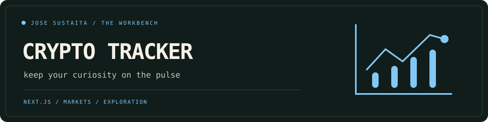

<p align="center"></p>

# Crypto Tracker ◇

A little window into crypto markets: search by name or ticker, sort the market, open coin details, and keep a watchlist on your device. Built with Next.js and React, with a floating gem and optional decorative motion.

## Start with Docker

Prerequisite: **Docker with Compose v2**. Use Bash/WSL for the helper script.

```bash
git clone --depth 1 https://github.com/josesustaita/Crypto-tracker.git
cd Crypto-tracker
./scripts/bootstrap.sh
```

Open **http://localhost:8083**. The script checks Docker, creates `.env` from the example without overwriting existing settings, runs the build tests, and waits for a healthy server. First build downloads dependencies; later runs use cached image layers.

The default is **demo mode**: six clearly labeled, illustrative coins. Values are not live prices. Search, sorting, details, and the watchlist work without an API key or runtime provider connection. Stars persist in this browser's local storage.

## Switch to live data

Edit the ignored `.env`:

```dotenv
CRYPTO_DATA_MODE=live
COINGECKO_API_KEY=your-optional-coingecko-demo-api-key
CRYPTO_PORT=8083
```

The key is optional for public access, subject to CoinGecko's access rules and rate limits. If used, it must be a **Demo API** key for `api.coingecko.com`; Pro API credentials use a different endpoint and are not supported by this setup. Keys remain server-side. Run the bootstrap again after editing `.env`.

Live mode fetches up to 100 coins in USD for the market page and individual coin data for detail pages from CoinGecko. Refresh to obtain another snapshot; the app does not stream prices. Unknown data or provider failures show an error rather than quietly switching to sample values. Watchlists contain coin IDs and persist on the current browser origin.

## Controls

- Search by a coin name or symbol, such as `Bitcoin` or `ETH`.
- Sort by market cap, 24-hour change, or name.
- Star coins, then open **Watchlist** to see only your saved IDs.
- Select a coin name to view its price, market cap, and trading volume.
- Clear a search or return to all coins from the empty state.

## Run, inspect, stop

```bash
./scripts/bootstrap.sh doctor
./scripts/bootstrap.sh logs
./scripts/bootstrap.sh test     # build tests + health check; leaves the app running
./scripts/bootstrap.sh down
CRYPTO_PORT=8093 ./scripts/bootstrap.sh
```

The app binds to loopback. No database is needed. `down` removes containers and the project network; it does not erase your browser watchlist or cached Docker images.

## Local development

Use **Node 22.12+**. Docker uses Node 22.

```bash
npm ci
npm test
npm run dev
# Production:
npm run build
npm start
```

Open http://localhost:3000. Next.js loads `.env` for local development. `NEXT_TELEMETRY_DISABLED=1` disables framework telemetry; the Docker image already sets it.

## Project map

- `pages/index.js` — market search, sort, and browser watchlist.
- `pages/coin/[id].js` — coin detail page and unknown-coin handling.
- `lib/markets.mjs` — sample data, provider boundary, normalization, and filtering.
- `components/` — layout, search control, and coin rows.
- `styles/globals.css` — responsive layout, animations, and reduced motion.
- `pages/api/health.js` — container health endpoint, independent of provider availability.
- `test/` — data, filtering, missing-detail, and provider-failure regression tests.

The multi-stage Docker build tests the data layer and creates a Next.js standalone runtime under an unprivileged user. Provider requests have an eight-second timeout. Demo data is local; live data is fetched at request time, so builds do not require provider credentials.

## Accessibility & motion

Search and sort have labels, watchlist buttons expose their pressed state, and results report their count. Gains and losses include signed/directional text. Mobile layouts keep essential fields visible. `prefers-reduced-motion` disables decorative movement and entry transitions.

## Troubleshooting

- **Docker won't connect:** start the daemon and run `doctor`.
- **Port already used:** change `CRYPTO_PORT` and rerun the bootstrap.
- **Live data unavailable:** check your key, public endpoint access, and provider rate limits. Switch `CRYPTO_DATA_MODE=demo` for a provider-free run.
- **Saved stars disappeared:** watchlists belong to this browser and origin. Changing the port, clearing site data, or private browsing uses different storage.

Before contributing, run `npm test` and `npm run build`. Licensed under [MIT](LICENSE).
